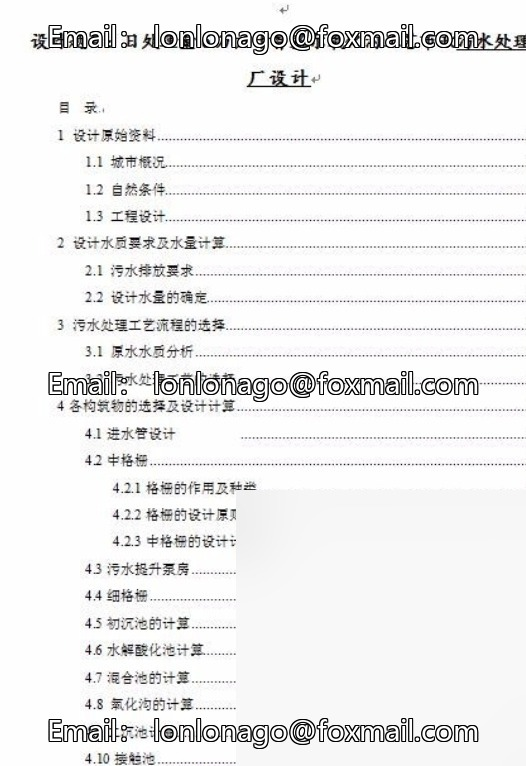
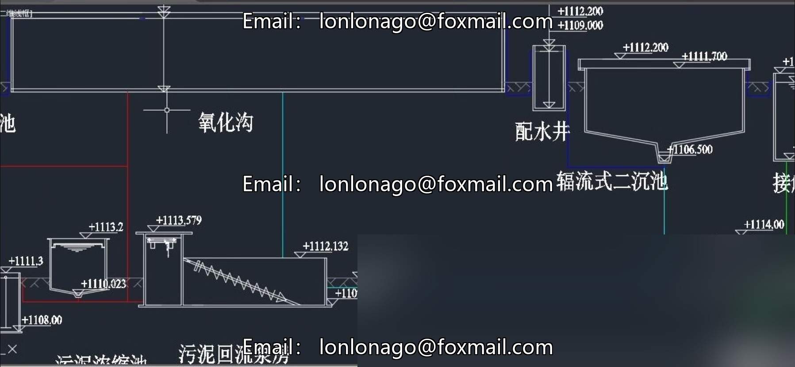

# Carusol oxidation pit process municipal sewage treatment plant design municipal sewage treatment plant design diagram

## Body

Carus oxidizing pond process for municipal sewage treatment plant design; municipal sewage treatment plant design drawing; municipal sewage treatment plant design CAD drawing

The images include a wastewater plant plan layout, the design title, design source materials, engineering chapters, and various calculation and facility details.

<!-- AI_ENRICHED -->

## Images

## Payment

Here is a pay link on Stripe ( https://buy.stripe.com/3cs8yP7sY87d0vu9AB ). Please contact me lonlonago@foxmail.com after funding $89, and I will send you a complete data files , thank you!

